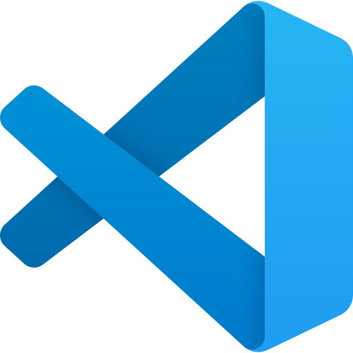
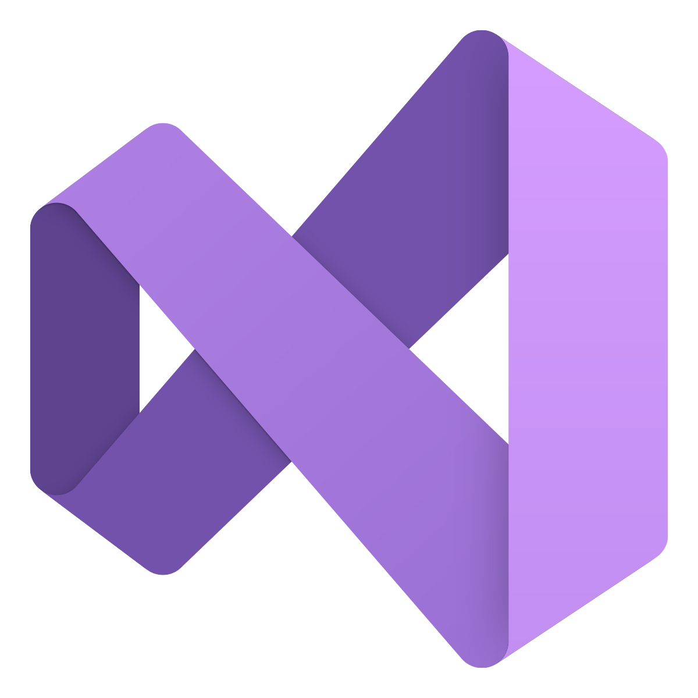
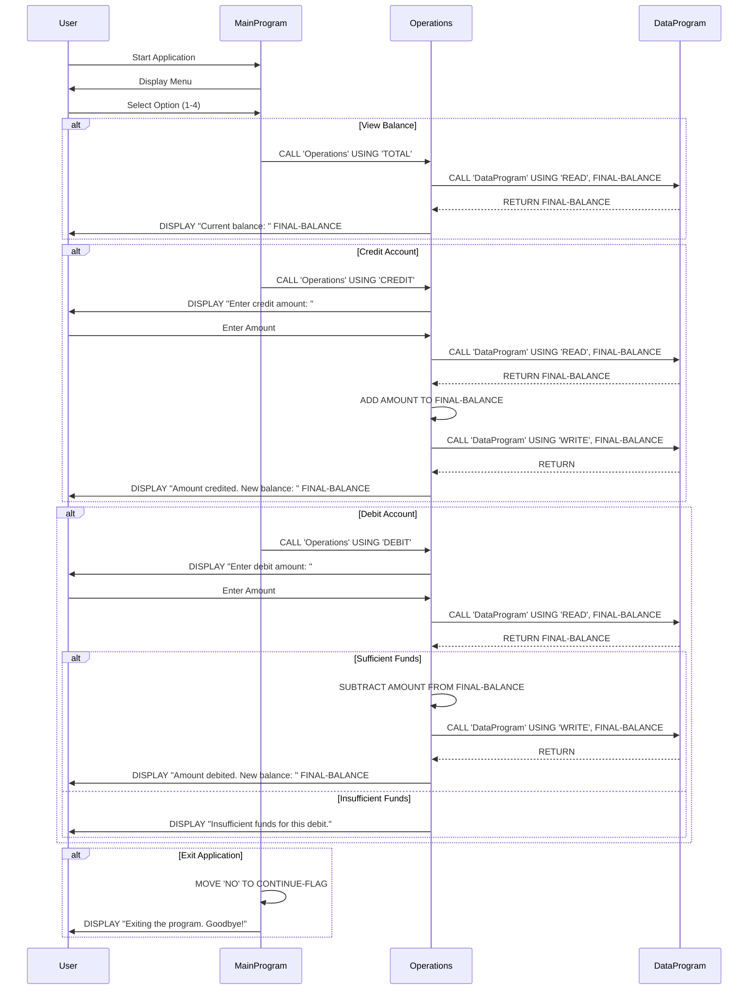

# Modernizing a Cobol accounting system to a C# or Node.js application using GitHub Copilot

This repo contains COBOL code for a simple accounting system. You can use GitHub Copilot to transform this code to a Node.js accounting system.

**Note: Keep in mind GitHub Copilot is an AI pair programmer that helps you write code. It is not a code generator and is using generative
models trained on public code. It may provide completions that are not perfect, safe, or otherwise suitable for production. Always review suggestions
and take a trust but verify approach.**


## Licensing

This app is a duplicate of the original, which can be found [here](https://github.com/continuous-copilot/modernize-legacy-cobol-app).
The original was licensed under the MIT license.
This repository has been adjusted to fit more properly in Betabit's AI-assisted coding trainings.

## Prerequisites

- Basic understanding of programming concepts.
- GitHub Copilot or GitHub Copilot Chat installed in your IDE.

## Nice-to-haves
- Basic understanding of the COBOL programming language.
- Knowledge of C# or node.js

## Setup the development environment

### Option 1: Use an IDE that supports GitHub Copilot

- IDE options for both GitHub Copilot and Copilot Chat:
  -  Visual Studio Code
  -  Visual Studio
  -  JetBrains IDE

#### For Visual Studio Code

- Install the GitHub Copilot and GitHub Copilot Chat extensions for Visual Studio Code.
- Install a COBOL extension for Visual Studio Code.

## About the program

This COBOL program simulates an account management system. This program will involve multiple COBOL source files and perform various operations like crediting, debiting, viewing the balance, and even exiting the program. Here’s how you its structured:

- Main Program (main.cob): The main program will handle the user interface and call subprograms for different operations.
- Operations Program (operations.cob): This program will handle the actual operations like credit, debit, and view balance.
- Data Storage Program (data.cob): This program will manage the storage of the account balance.

## Steps to Compile and Run the Program (optional)

- Option 1: Install COBOL compiler on MaC
If you don't already have a COBOL compiler, you'll need to install one. Common COBOL compiler is GnuCOBOL: An open-source COBOL compiler. To Install , use brew:

```bash
brew install gnucobol 
```

- Option 2: Open the terminal in the GitHub codespace or Ubuntu Linux system and run the following command to install the COBOL compiler:

```bash
sudo apt-get update && \
sudo apt-get install gnucobol
```

reference: [gnucobol](https://formulae.brew.sh/formula/gnucobol)

- Compile, link and create executable: Link the object files together to create the final executable:

```bash
cobc -x main.cob operations.cob data.cob -o accountsystem
```

- Run the Program: Run the executable to start the account management system:

```bash
./accountsystem
```

## Program Interaction Example

- Program starts with user input menu

```bash
--------------------------------
Account Management System
1. View Balance
2. Credit Account
3. Debit Account
4. Exit
--------------------------------
Enter your choice (1-4): 
```

- User Chooses to View Balance:

```bash
Current balance: 1000.00
```

- User Chooses to Credit:

```bash
Enter credit amount:
200.00
Amount credited. New balance: 1200.00
```

- User Chooses to Debit:

```bash
Enter debit amount:
300.00
Amount debited. New balance: 900.00
```

- User Chooses to Exit:

```bash
Exiting the program. Goodbye!
```

## Explanation

- main.cob: This is the main interface where users select operations.
- operations.cob: It handles specific operations such as viewing, crediting, and debiting the account balance.
- data.cob: This program acts as a simple data storage, handling reading and writing of the balance.

This multi-file structure introduces modularity, making it easier to manage and extend the program. Each file has a clear responsibility, and the program flow is driven by user interaction.

### Data flow

```text
@workspace can you create a sequence diagram of the app showing the data flow of the app. Please create this in mermaid format so that I can render this in a markdown file.
```



## Generate a test plan

```text
@workspace The current Cobol app has no tests. Can you please create a test plan of current business logic that I can use to validate with business stakeholders about the current implementation.
Later I would like to use this test plan to create unit and integration tests in a node.js app. I am in the middle of transforming the current Cobol app to a node.js app.
The test plan should include the following:

1. Test Case ID
2. Test Case Description
3. Pre-conditions
4. Test Steps
5. Expected Result
6. Actual Result
7. Status (Pass/Fail)
8. Comments

Please create the test plan in a markdown table format. The test plan should cover all the business logic in the current Cobol app.
```

### Note

*You may still need follow up with another prompt to generate the markdown file format for the test plan.*

```markdown
Convert this to markdown syntax please to insert as a new file
```

## Convert files using prompt engineering best practices

### Create the Node.js project directory

```bash
mkdir node-accounting-app
cd node-accounting-app
```

### Use GitHub Copilot to convert the files iteratively

#### Convert main.cob to main.js

#### Convert operations.cob to operations.js

#### Convert data.cob to data.js

```text
Let's link all node.js files to work together in one accounting application, and then initialize, install dependencies, and run the application.
```

### Initialize a new Node.js project

```bash
npm init -y
```

### Install the Node.js app

```bash
npm install

```

### Run the Node.js app

```bash
node main.js
```

### Generate unit and integration tests

```text
@workspace I would like to create unit and integration tests cases form the test plan mentioned in
#file:TESTPLAN.md file The node.js code is in node-accounting-app folder and I am looking to generate tests
for #file:operations.js file. Use a popular testing framework and also provide all the dependencies required to run the tests.
```

## License

This project is licensed under the MIT License - see the [LICENSE](LICENSE) file for details.

## Modernisierte Version (ASP.NET Core + Vanilla JS)

Die COBOL-Dateien (`main.cob`, `operations.cob`, `data.cob`) bleiben unverändert als Referenz.

### Start

```
dotnet run --project src/Accounting.Web
```

Dann die ausgegebene URL (z. B. `http://localhost:5000`) öffnen. Tests: `dotnet test tests/Accounting.Tests`. Voraussetzung: .NET 8 SDK oder neuer.

### API

Alle Beträge sind ganze Zahlen in Hundertsteln (`100000` = 1000,00). Keine Gleitkommaarithmetik.

- `GET /api/account/balance` → `{"balanceCents": n}`
- `POST /api/account/credits` und `POST /api/account/debits` mit `{"amountCents": n}` → bei Erfolg `{"balanceCents": n}`
- `400 invalid_amount`: fehlend, kein Integer, negativ, Dezimalzahl oder größer als 99999999
- `409 overflow`: Saldo würde 99999999 überschreiten
- `409 insufficient_funds`: Abbuchung größer als Saldo (exakt auf 0 ist erlaubt)
- Fehlerantworten enthalten den unveränderten `balanceCents`. Der Betrag `0` ist erfolgreich und schreibt nichts.

### Datenbank

SQLite-Datei `accounting.db` (Pfad per Konfiguration `Database:Path`, z. B. `--Database:Path=/pfad/konto.db`). Genau ein Konto, einmalig mit 100000 (1000,00) angelegt; danach bleibt der Saldo über Neustarts erhalten. Buchungen sind je ein bedingtes `UPDATE … RETURNING`, daher gehen bei gleichzeitigen Anfragen keine Änderungen verloren und Grenzen werden nie verletzt. Zum Zurücksetzen die Datei löschen. Es gibt keine Buchungshistorie.

### Nutzungsgrenzen

Nur für lokale Nutzung: kein Login, keine Benutzerverwaltung, ein einziges Konto. Nicht ohne vorgeschalteten Zugriffsschutz im Netz oder öffentlich betreiben.

### Bewusste Abweichungen zu COBOL

Gemessen mit GnuCOBOL 3.1.2 (WSL Ubuntu), `cobc -x main.cob operations.cob data.cob`:

| Fall | COBOL (gemessen) | Neu |
|---|---|---|
| Start, Gutschrift 200, Abbuchung 300 | 1200,00 → 900,00 | identisch |
| Abbuchung exakt auf 0; danach 0,01 | 0,00; „Insufficient funds“ | identisch |
| Überziehung | „Insufficient funds“, Saldo unverändert | 409 `insufficient_funds` |
| Betrag 0 | „credited“, Saldo gleich | Erfolg, kein Schreiben |
| Neustart | Saldo wieder 1000,00 (nur WORKING-STORAGE) | Saldo bleibt in SQLite |
| Überlauf (+999000,00 auf 1000,00; Limit 999999,99) | Saldo wird still auf 0,00 abgeschnitten | 409 `overflow`; Limit 999999,99 (99999999) |
| Betrag > 999999,99 (1000000,00) | stille Abschneidung, Saldo +0 | 400 `invalid_amount` |
| Eingabe `abc` | als 0 gebucht | 400 / UI-Fehler |
| Eingabe `-5` | als +5,00 gebucht (Vorzeichen verloren) | abgelehnt |
| Eingabe `1.005` | stilles Abschneiden → +1,00 | UI lehnt >2 Nachkommastellen ab (kein Runden) |

Die Alt-Eigenheit, dass `Operations` den `'READ'`-Literal (4 Zeichen) an `DataProgram` übergibt, dessen Linkage 6 Zeichen erwartet, wurde nicht übernommen; im Ergebnis funktionierte der COBOL-Lauf trotzdem.
